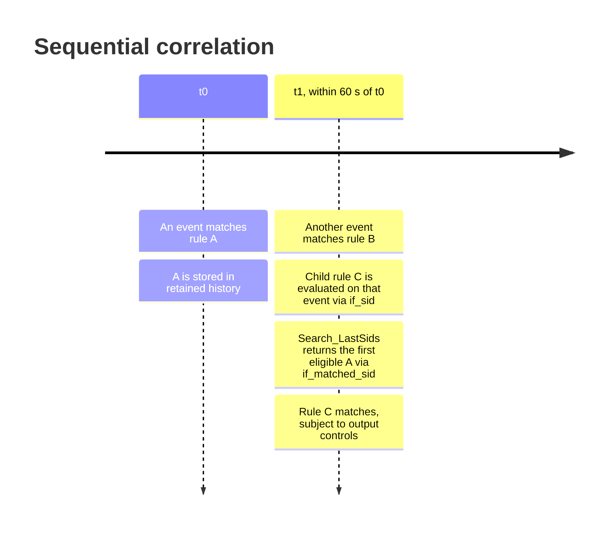

In [Understanding Wazuh rules](https://zaferbalkan.com/wazuh-rules/), I described Wazuh rules as building blocks connected through explicit relationships rather than independent filters. [Part II: metadata and conditions](https://zaferbalkan.com/wazuh-rules-metadata-conditions/) looked inside those blocks and separated their conditions into atomic and temporal, according to the state required to evaluate them. An atomic rule decides from the current event and its current rule-evaluation path; a temporal rule needs retained information from earlier events.

The temporal examples focused on counting repeated matches: several failed logons, multiple Windows errors, or another threshold reached within a timeframe. But counting is not the only useful relationship between events. Sometimes the question is whether one kind of event occurred first and another kind occurred afterwards. This is sequential correlation.

It may look as though we need a separate correlation engine or a new rule language for that. In Wazuh 4.x, a limited but useful A-then-B pattern can be expressed by combining an ordinary current-event parent with a historical rule reference. The pattern also needs no explicit `frequency` attribute, which takes some explaining.

The example below targets Wazuh v4.14.10 and uses placeholder IDs from the [custom rule range of 100000–120000](https://documentation.wazuh.com/current/user-manual/ruleset/rules/custom.html), standing in for parent rules you define yourself. The rule itself is a fragment, and the final section runs it with stand-in parent rules against a manager.

## tl;dr

To make rule C fire when rule A matched earlier and rule B matches now, write C as a child of B that searches retained history for A. C is a rule match on B's event, not a third incoming event.

```xml
<!-- C: fires when B matches now and A matched within the last 60 seconds -->
<rule id="100575" level="12" timeframe="60">
    <if_matched_sid>100570</if_matched_sid> <!-- A: searched in retained history -->
    <if_sid>100505</if_sid>                 <!-- B: parent of the current event -->
    <same_srcip />                          <!-- join key: A and B share srcip -->
    <description>Correlated events from $(srcip). </description>
    <description>Potential password spraying.</description>
    <mitre>
        <id>T1110</id>
    </mitre>
    <group>password_spray,</group>
</rule>
```

Six practices keep this pattern correct:

1. **Put A in `if_matched_sid` and B in `if_sid`.** Swapping them reverses the order, because the rule then runs on A's event and searches history for B.
2. **Leave `frequency` out.** One eligible earlier A is enough. Explicit `frequency="2"` behaves identically, while `0` or `1` fails rule loading and stops `analysisd` on restart.
3. **Set `timeframe` explicitly.** Without it, the search window falls back to the 360-second default.
4. **Join on a field both events populate.** `<same_srcip />` needs the decoded `srcip` on A and on B, and an address that exists only in a dynamic field such as `win.eventdata.ipAddress` does not count. The search also requires the same agent unless `global_frequency` is set.
5. **Give A a positive level.** A level-0 rule cannot serve as the historical source, so suppress A's output instead of lowering its level if you do not want it to alert.
6. **Test before restarting the manager.** Run `wazuh-analysisd -t` to catch load errors, then replay an A event followed by a B event in one `wazuh-logtest` session.

A matching rule still passes through the usual output controls, so a match does not guarantee an emitted alert. The rest of this article explains why each practice holds.

## Sequential conditions within the temporal class

Wazuh 4.x supports three practical patterns worth distinguishing when designing detections:

| Pattern | Question | Mechanism |
| --- | --- | --- |
| **Atomic** | Does this event match? | Event predicates and same-event rule ancestry, such as `field` and `if_sid` |
| **Temporal counting** | Have enough matching events occurred within a window? | `if_matched_sid` or `if_matched_group`, with `frequency` and `timeframe` |
| **Sequential correlation** | Did A happen before the current B within a window? | Historical `if_matched_sid` for A combined with structural `if_sid` for B |

Sequential correlation remains temporal under the state-based classification from Part II. It is a pattern *within* temporal conditions rather than a third state category.

In Part II, a Windows error event matched by rule `60011` was an atomic example. Rule `60014`, which looks for several matches of `60011` within a timeframe, was temporal. The distinction was based on state, not on how many techniques the detection represented. A sequential condition also needs state, but asks a different question: what occurred before the current event?

We can express the patterns conceptually as follows:

```text
Atomic:    B(now)
Temporal:  COUNT(A in recent history) >= threshold
Sequential: B(now) AND EXISTS(A in recent history, related to B)
```

The last condition specifies an order relative to the engine's evaluation: A must already be in the history when B is processed. It does not mean Wazuh provides a general-purpose ordered-sequence language, or that arbitrary multi-stage process lineage can be reconstructed from these constructs alone.

The pattern rests on two dependencies that look similar in XML but operate over different state. `if_sid` controls the current event's structural evaluation path, while `if_matched_sid` searches historical matches. Both can appear within the same rule, with further comparison conditions restricting the historical candidate.

### Where the pattern fits

Consider a rule A that identifies suspicious authentication attempts and a rule B that identifies a successful authentication. A repeated-failure threshold can be useful, but a more targeted detection may ask whether a successful authentication follows a previously suspicious attempt from the same source. The sequential pattern can express the A-then-B relationship without requiring A to repeat. Whether the resulting behaviour actually amounts to password spraying depends on what the two input rules mean; the ATT&CK mapping alone cannot establish that.

Other applications include a configuration change followed by an error, or a warning followed by a successful operation. For each, the input rules must already provide meaningful event classifications and the comparison key must be available in both records. A-then-B with a shared IP is weaker evidence than A-then-B with a proven same-process relationship.

### What makes a rule sequential

When a current event matches B and descends into C, B is part of the same event's evaluation. `if_sid` therefore never refers to a previously fired rule, and only A comes from history. A historical selector makes the rule sequential, whereas `timeframe` on its own only sizes a window that nothing searches.

## One current event, one earlier event

Think of the intended sequence as A → B → C. An earlier event matches rule A and a later event matches rule B. Rule C is then evaluated as a child of rule B and checks retained history for a qualifying match of rule A. C is the correlation decision taken on B's event.



`<if_sid>` places rule C under rule B, the current-event parent, in Wazuh's accepted rule-occurrence tree, without requiring that rule B fired previously. `<if_matched_sid>` instead directs the engine to search its retained historical matches for rule A. Wazuh's loader [wires that historical condition](https://github.com/wazuh/wazuh/blob/v4.14.10/src/analysisd/rules.c#L1965-L1971) to `Search_LastSids()` in `analysisd`.

The `<same_srcip />` condition further restricts the search: the historical event's decoded `srcip` must exist and equal the current event's `srcip`. The historical search also requires matching agent identity by default, unless `global_frequency` changes that scope. Merely seeing an IP address in a Windows dynamic field such as `win.eventdata.ipAddress` is not sufficient to establish that Wazuh has populated its standard `srcip` attribute.

The remaining elements of rule C are ordinary metadata. Its `level="12"` means a successful match reports level 12, and its two `<description>` elements are concatenated, so put punctuation and whitespace where needed. The placeholder `$(srcip)` substitutes the current event's decoded source IP when present. The [`T1110`](https://attack.mitre.org/techniques/T1110/) MITRE ATT&CK mapping and `password_spray` group label are descriptive metadata; they do not establish that the preceding events are in fact password spraying. That conclusion depends on what the parent rules detect and on the validity of the correlation.

The XML spelling `<same_source_ip />` is still recognised by the v4.14.10 parser, but the [Wazuh documentation](https://documentation.wazuh.com/current/user-manual/ruleset/ruleset-xml-syntax/rules.html) marks it as a deprecated alias. Prefer `<same_srcip />` in new examples.

## The frequency detail: why one earlier event is enough

The counterintuitive part is that the stored value differs from the XML attribute. The loader starts each rule with an internal frequency of zero. When an explicit frequency is supplied, it [verifies that the XML value lies between 2 and 9999, then subtracts two](https://github.com/wazuh/wazuh/blob/v4.14.10/src/analysisd/rules.c#L2317-L2325):

```text
internal_frequency = XML_frequency - 2
```

When the attribute is omitted, no subtraction occurs and the initial zero remains. Consequently, omission and explicit `frequency="2"` have identical stored frequency values for otherwise equivalent rules.

The subtraction makes sense for the counting pattern. A counting rule usually carries only `if_matched_sid`. The loader then [copies that SID into the rule's `if_sid`](https://github.com/wazuh/wazuh/blob/v4.14.10/src/analysisd/rules.c#L1679-L1686), so the current event is itself an A and the search needs one fewer A from history. One unit accounts for the current event; the other comes from the strict comparison in the search loop shown below. Our rule supplies its own `if_sid` for B, which is why the same arithmetic yields one historical A rather than one A in total.

| XML frequency | Stored internal frequency | Eligible previous A events sufficient in `Search_LastSids()` |
| --- | ---: | ---: |
| Omitted | 0 | 1 |
| `2` | 0 | 1 |
| `3` | 1 | 2 |
| `4` | 2 | 3 |
| `5` | 3 | 4 |
| `0` or `1` | Not stored | Configuration error |
| `10000` or above | Not stored | Configuration error |

These historical counts describe the examined `Search_LastSids()` path with a separate current B event. They should not be generalised into a formula for every Wazuh correlation mechanism or output option.

### Internal zero still requires a historical match

A stored threshold of zero leaves the rule active. The [historical search](https://github.com/wazuh/wazuh/blob/v4.14.10/src/analysisd/eventinfo.c#L99-L270) initialises `frequency_count` to zero and walks the retained candidates from newest to oldest. When the stored threshold is zero, its condition `frequency_count < rule->frequency` becomes `0 < 0`, which is false. It therefore proceeds to the matching branch for the first eligible historical candidate. It cannot match with no historical A: if the search list is empty or every stored candidate fails the age, agent, IP, or other checks, the historical condition fails.

This is why describing `frequency="2"` as "two earlier A events" would be incorrect for this combined-parent example. The current B provides the separate present-time condition; the historical search needs only one qualifying A.

### Explicit zero or one fails at load time

You can save such a file, but the attribute parser rejects explicit `frequency="0"` and `frequency="1"`, reports an error, and ends loading of that rule file unsuccessfully. The failure therefore surfaces when the rules are loaded rather than as an accepted rule that later stays silent. Check configuration validity before restarting a manager with modified rules.

I find this behaviour counterintuitive, and my objection is to where the check happens. A single invalid attribute in one custom rule file [makes `analysisd` exit](https://github.com/wazuh/wazuh/blob/v4.14.10/src/analysisd/analysisd.c#L729-L753) on the next restart, so a typo in a correlation rule stops analysis for every agent until someone fixes it. My stance follows Alexis King's [Parse, don't validate](https://lexi-lambda.github.io/blog/2019/11/05/parse-don-t-validate/): turn less-structured input into a more precise type at the boundary, so that invalid states cannot be represented once inside.

The Wazuh loader validates the XML and keeps a bare integer, which is why `frequency="2"` and an omitted attribute collapse into the same stored zero. The rule that `frequency` or `same_srcip` needs an `if_matched_*` selector is [checked separately](https://github.com/wazuh/wazuh/blob/v4.14.10/src/analysisd/rules.c#L1662-L1669), after all elements are read. In a rule language that parses, a sequential rule would be its own type requiring both a historical selector and a structural parent, and a counting threshold below two could not be written at all. The boundary for that parse is authoring time, in the editor or in CI, so the running service only receives rules that already have their final shape. Until then, `wazuh-analysisd -t` runs the same loader against the configured rule files and exits without starting the daemon, which moves the failure earlier without changing its nature.

## Omitted `timeframe` falls back to the default window

The parser initialises the rule's timeframe from `analysisd.default_timeframe`. In Wazuh 4.14.10, the [built-in default](https://github.com/wazuh/wazuh/blob/v4.14.10/src/analysisd/rules.c#L242) is 360 seconds, subject to the permitted internal configuration override. Writing `timeframe="60"` overrides this with a 60-second historical search window. Setting a timeframe by itself does not create a historical dependency: a rule with `<if_sid>` but no historical selector remains an ordinary current-event child rule.

The examined historical SID search rejects a stored candidate when `now - generate_time > timeframe`, where `now` is obtained from the manager's current time. Thus a candidate at the exact 60-second boundary is not rejected by that comparison alone, but may still fail another condition. The comparison is an age check on retained history measured on the manager's clock, so delayed ingestion or clock changes can make it differ from the gap between the two source-system timestamps.

## Inside `analysisd`: placement and search

The frequency section covered loading. The two remaining stages, structural placement and historical evaluation, explain why rules B and A play different roles in rule C.

### Structural attachment

During tree construction, [`OS_AddChild()`](https://github.com/wazuh/wazuh/blob/v4.14.10/src/analysisd/rules_list.c#L139) uses the rule's `<if_sid>` to find qualifying accepted rule occurrences. In our example, rule C is attached under rule B according to the loader's traversal and insertion rules. This relationship governs how the current event is evaluated and carries no information about the earlier event in the sequence.

### Historical search and eligibility

`if_matched_sid` is a separate dependency: the loader registers the referenced rule for historical matching and configures the search using `Search_LastSids()`. That function inspects retained events, normally restricting results to the same agent. It rejects candidates outside the timeframe or lacking the required equal source IP. It also checks historical matched-level state. A candidate already marked at or above the correlation rule's level ends the search without a match, which prevents repeated or lower-level correlations from reusing an earlier event without restriction.

The relevant section of the search is:

```c
if (frequency_count < rule->frequency) {
    frequency_count++;
    if (!first_matched) {
        first_matched = lf;
    }
    continue;
}
frequency_count++;
my_lf->matched = rule->level;
```

With internal frequency zero, the first eligible candidate enters the matching branch. Without that candidate, the search fails. The lines that follow mark only `first_matched` and the current event, and `first_matched` stays empty at frequency zero. The historical A therefore stays unconsumed, and a second B inside the window can correlate against the same A. A level-0 historical source cannot serve this purpose according to the [Wazuh rule syntax documentation](https://documentation.wazuh.com/current/user-manual/ruleset/ruleset-xml-syntax/rules.html); define A at a positive level and suppress its output if necessary. Also distinguish matched from emitted: `noalert`, `no_log`, alert thresholds, and other output controls can affect whether an alert is produced, even when conditions match.

## Where native correlation stops

A single Wazuh 4.x rule can combine `if_matched_sid` for A with `if_sid` for B, and omitting `frequency` lets the first eligible historical A satisfy the search. That compact form still depends on source-rule eligibility, event ordering, structural reachability and alert suppression. Two event types alone do not justify an external correlator; first check whether native history and equality constraints express the relationship, using the practices in the tl;dr. A shared source IP is weaker evidence than verified process provenance, and when the relationship needs provenance, arbitrary joins or stronger causal evidence, a dedicated correlator may still be necessary.

For analysers such as [RuleVis](https://github.com/zbalkan/rulevis), preserve the distinction between the written XML frequency, its normalised runtime value, and the number of historical events sufficient for a particular search path. Also distinguish the structural `<if_sid>` edge from the temporal `<if_matched_sid>` dependency. An explanatory graph may show both, but it should not represent them as equivalent parent relationships in Wazuh's occurrence forest.

## The scenario table is a test suite

I traced these outcomes in the v4.14.10 source before testing them:

| Event sequence and conditions | Expected result for rule C |
| --- | --- |
| B without a prior A | No correlation |
| A without a following B | No correlation |
| A → B, same agent and source IP, within 60 seconds | Eligible correlation candidate |
| A → B, different source IPs | No correlation |
| A → B, missing `srcip` on either event | No correlation |
| A → B, different agents, default settings | No correlation |
| A → B after the configured 60-second window | No correlation |
| B → A, without another B after A | No correlation for the earlier B |
| A → A → B within the window | One eligible historical A may suffice; output remains subject to other checks |
| A → B → B within the window | Each B may correlate against the same A, because the search does not mark A at internal frequency zero |
| `frequency="2"` instead of omission | Same stored frequency threshold |
| `frequency="1"` | Rule-file loading error |

That table is already a specification, so it can run as one. In [Detection-as-Code for Wazuh 4.x: A Practical Implementation Model](https://zaferbalkan.com/wazuh-devenv/), I described a workspace where rules, decoders and tests live together and run against the manager's logtest daemon. [Log replay for behavioural testing](https://zaferbalkan.com/log-replay/) extended that model to sequences of events, and sequential correlation needs that extension, because no single event can show the pattern.

I ran the article's claims through that workspace with a small demo decoder and stand-in rules A and B, keeping rule C as written in the tl;dr. Each scenario sends its events through one logtest session, since every session loads its own ruleset and keeps its own history:

```python
# suspicious() and success() build syslog lines that match rules A and B.
@pytest.mark.parametrize(
    ("logs", "expected"),
    [
        pytest.param([success()], [RULE_B], id="B without a prior A"),
        pytest.param([suspicious(), success()], [RULE_A, RULE_C], id="A then B"),
        pytest.param([success(), suspicious()], [RULE_B, RULE_A], id="B then A"),
        pytest.param([suspicious(), success(OTHER_IP)], [RULE_A, RULE_B], id="different srcip"),
        pytest.param([suspicious(), success(), success()], [RULE_A, RULE_C, RULE_C], id="A then B then B"),
    ],
)
def test_sequence_outcome(logs: list[str], expected: list[str]) -> None:
    responses = send_multiple_logs(logs)
    assert [response.rule_id for response in responses] == expected
```

The suite passed on a v4.14.10 manager, as the test tree below shows. That includes the A → B → B case, which follows from the internal frequency of zero, and the window test, which waits on the manager's clock.



The load-time failure is outside what these tests can show, because a ruleset containing `frequency="1"` never loads and no logtest session can observe it. In a pipeline, `wazuh-analysisd -t` catches it before a manager restarts, which moves the validation earlier without giving the parse-time boundary I argued for above. [The Concept Beneath Detection-as-Code](https://zaferbalkan.com/dac-concept/) argued that making a detection's requirements explicit produces an evaluation criterion. The scenario table was that criterion in prose, and the test file is the same criterion in a form a pipeline can enforce. The complete files are in [Github](https://github.com/zbalkan/wazuh-sequential-rules).

Run `wazuh-analysisd -t` and `python -m pytest tests -m "not slow"` on every change, and the full suite, including the window test, before a release.
