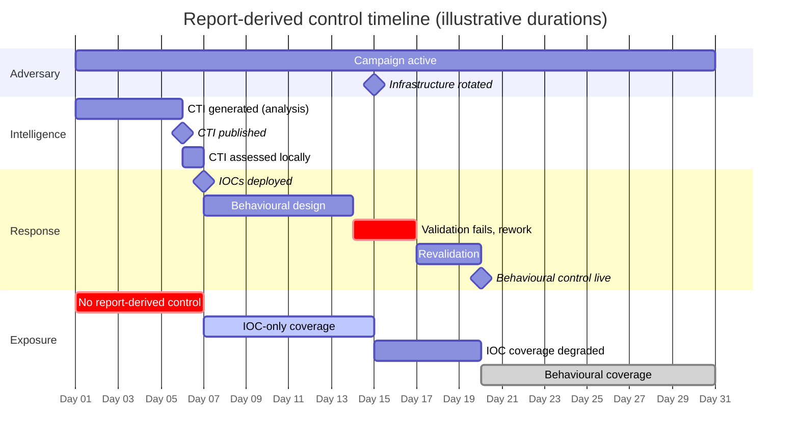

A friend who leads a detection team told me recently that he did not want his team using indicators of compromise at all. He argued that hashes, domains and addresses cost an adversary almost nothing to replace, so engineering hours belong on behaviours that survive a change of tools. The reasoning was familiar and mostly sound, and I disagreed only with the conclusion, because a behavioural control does not exist on the day the threat report arrives. I described indicators to him as first aid, which stabilises the patient while the behavioural treatment is prepared and is removed once that treatment works.

His position, and the case usually made against indicators, rests on five arguments, and each of them is right about something. [Robustness research](https://center-for-threat-informed-defense.github.io/summiting-the-pyramid/overview) offers a useful test for these arguments, namely what the adversary could change to evade a detection while still reaching the same objective. The test applies to my side of the discussion too, and one popular way of combining the two approaches fails it. In this piece, indicators are concrete observables tied to a known threat, such as hashes, addresses, domains, URLs and infrastructure fingerprints, although RFC 9424 also counts techniques.

## "Indicators are old school"

The first objection treats the age of a technique as evidence about its value, although the two are unrelated. Indicator matching predates behavioural analytics, yet the practice around it has kept developing. The IETF published [RFC 9424](https://www.rfc-editor.org/rfc/rfc9424.html) in 2023 to define the role of indicators in attack defence, including a lifecycle that runs from discovery to end of life. Sharing platforms score indicators with [decay models](https://www.misp-project.org/2019/09/12/Decaying-Of-Indicators.html) and publish [warning lists](https://github.com/MISP/misp-warninglists) of shared cloud and CDN ranges. Operating system vendors also maintain indicator-based blocklists for vulnerable drivers, which Microsoft updates on a [quarterly schedule](https://learn.microsoft.com/windows/security/application-security/application-control/app-control-for-business/design/microsoft-recommended-driver-block-rules).

In interviews about commercial intelligence, thirteen of fourteen practitioners named network detection, largely through SIEM and IDS ingestion, as one of its uses ([Bouwman et al., 2020](https://www.usenix.org/conference/usenixsecurity20/presentation/bouwman)). In a managed SOC studied over 390 days, rules matching domain names in DNS requests contributed to over 75% of its 42 incidents ([Teuwen et al., 2025](https://doi.org/10.1145/3708821.3710823)). The authors caution that their largest customer's sensors mostly saw DNS traffic, so the result does not measure indicator value beside endpoint behavioural detection. The part of the practice that has aged is the unmanaged feed, a list of addresses appended to indefinitely and never reviewed. Most of the objections below are aimed at that feed, whereas the indicator itself remains the fastest control a team can deploy from a new report.

## "Indicators are trivial to evade"



The [Pyramid of Pain](https://detect-respond.blogspot.com/2013/03/the-pyramid-of-pain.html) supports the second objection, which is correct about durability. Replacing a hash costs a recompile, while replacing a procedure costs new tooling and new practice. RFC 9424 describes the trade-off from the defender's side, where a more specific indicator is more fragile and a less specific one carries a higher false-positive risk. Measurement suggests, however, that adversaries often change infrastructure before disclosure forces them to. A study of 405 APT actors found that 73.6% of the addresses they used no longer pointed to their domains by first public disclosure ([Avgetidis et al., 2025](https://zanema.com/papers/raid25_apt_lifecycle.pdf)). A published indicator therefore often records past activity, which makes retrospective search as important as blocking. The pyramid ranks how costly each observable is for the adversary to change, which bears on how long a control stays useful without measuring it. It is also silent on the period between a report arriving and a durable control existing.

The timeline separates the stages that set the impact window, with durations that vary by organisation and by report, and it shows a favourable case. The adversary is active before any report exists, and intelligence arrives late even when it is good. A [comparative study of threat intelligence feeds](https://www.usenix.org/conference/usenixsecurity19/presentation/li) found that most scan feeds listed scanning addresses a median of one to three days after a network telescope first observed them. Across 24 open feeds, most indicators were active for at least 20 days before being listed, with an average delay of 21 days ([Griffioen et al., 2020](https://doi.org/10.1007/978-3-030-57878-7_14)). Once assessed, indicators from a report can be deployed within hours, while infrastructure rotation partway through the campaign is why their coverage weakens over time.

Controls derived from a report cannot act before it exists, so the days before it depend on controls already running and on intelligence about infrastructure still in preparation. A prediction system at the .eu registry flagged malicious registrations before the domains became operational and contributed to the suspension of 58,966 domains in 2018 ([Desmet et al., 2021](https://doi.org/10.1145/3419476)). Within two years, most malicious registrations it missed came from new registrants. Its authors read this as attackers varying their details daily or moving to other top-level domains, so pre-attack detection faces the same evasion question as every other control. Infrastructure fingerprints show a similar trade-off between precision and reach. In one study, 95% of newly listed C2 servers carried a TLS fingerprint already seen for that malware family ([Sosnowski et al., 2022](https://arxiv.org/abs/2206.13230)). Adding the HTTP server header identified new servers with 99% precision, although it found only 35% of them. Some providers now treat such [pre-attack indicators](https://lab539.com/blog/pre-attack-indicators) as a separate category, since the same address can describe an adversary's preparation before it describes a compromise.

## "Behavioural detection makes indicators redundant"

The third objection assumes the behavioural control already exists and works. Consider a report describing a command-and-control domain, a dropper hash and a scheduled task for persistence. The domain and hash can be searched and blocked within hours. The behavioural rule requires mapping the ways of creating a task, confirming the telemetry, writing the logic, and testing it against malicious and benign activity. I found no published measurement of how long that work takes in a real team, so each team should replace the assumption with its own figure.

The rule may also cover less than its label claims. A rule can detect one implementation of a technique while its ATT&CK tag claims all of them. An exclusion for an administrative account becomes a blind spot once that account is compromised. An [assessment of 144 Sigma analytics](https://ctid.mitre.org/blog/2026/09/29/windows-security-case-study) mapped to 84 techniques found meaningful coverage of at least one implementation for only 26 of them, with roughly 26.8% coverage across implementations. Until validation succeeds, the indicators are the only deployed response to the reported activity.

Redundancy also fails at the other end of the timeline, because some indicators are the treatment itself. A vulnerable kernel driver is a legitimate, signed file, and loading a signed driver is normal behaviour on any Windows estate. A hash, or a signer rule scoped to the affected file names and versions, separates the vulnerable version from ordinary driver activity more precisely than any behavioural rule. That is why [vulnerable-driver blocklists](https://learn.microsoft.com/windows/security/application-security/application-control/app-control-for-business/design/microsoft-recommended-driver-block-rules) remain indicator-based and receive scheduled updates instead of being replaced. The list is still incomplete, since Microsoft states that it holds back some blocks to avoid breaking functionality and recommends allowlisting wherever possible. A 2026 study also found abused drivers missing from both Microsoft's list and the LOLDrivers catalogue, including one whose vulnerability has been known since 2010 ([Monzani et al., 2026](https://www.ndss-symposium.org/wp-content/uploads/2026-s1491-paper.pdf)). The indicator stays the treatment for known drivers, and allowlisting reduces exposure to drivers no list has caught yet, though not to vulnerable drivers it already permits.

## "Indicators flood analysts with false positives"

The fourth objection is strongest at the bottom of the pyramid, in IP addresses. An adversary who rents a cloud virtual machine releases the address when they move on, and the provider assigns it to another tenant. Researchers who repeatedly allocated servers in one AWS region received 1.5 million unique addresses within 101 days, about 56% of the region's pool ([Pauley et al., 2022](https://arxiv.org/abs/2204.05122)). An address can also belong to a CDN or shared front end serving many legitimate customers. Blocking it cuts off business traffic, and alerting on it sends analysts to investigate a partner's API.

The risk depends on the indicator type and the action taken, and RFC 9424 already separates those actions into logging, active monitoring and outright blocking. An evaluation of 157 IP blocklists using 2016 data found that expanding listed addresses to their /24 prefixes raised misclassification to 67.2% for one list ([Ramanathan et al., 2020](https://www.ndss-symposium.org/wp-content/uploads/2020/02/24232-paper.pdf)). The authors warn that naively aggregating and expanding listed addresses would amplify the misclassification of legitimate sources. Domains and URLs make more precise blocks than the addresses they resolve to. Address indicators can be checked against published [cloud and CDN range lists](https://github.com/MISP/misp-warninglists) before deployment, given short lifetimes, and kept to logging or monitoring inside shared ranges.

The comparative feed study shows why those checks matter, since 12 IP feeds contained reserved addresses that should never appear on a public network. Twenty-one feeds also contained addresses belonging to top-ranked legitimate domains, whose blocking would disrupt benign services. Rule-based network detection carries the same burden in a different form. In one managed security service provider's network IDS rulesets, 0.5% of rules produced over 80% of alerts, and only 1.2% of alerts merited closer investigation ([Vermeer et al., 2022](https://doi.org/10.1145/3488932.3517412)). Behavioural analytics share the problem, since the robustness method's [scheduled-task example](https://center-for-threat-informed-defense.github.io/summiting-the-pyramid/analytics/task_scheduling/) notes that a more robust analytic generates a large number of false positives unless combined with other observables.

## "Maintaining indicator feeds wastes engineering capacity"

The fifth objection is right about more than manual handling, because lifecycle management carries a cost of its own. Every indicator deployed as a standing control needs a confidence check, a lifetime, a false-positive review and a retirement decision. Those costs stay the same whether the indicator proves valuable or worthless. One head of SOC interviewed in the commercial-intelligence study described a paid source as having negative value, because its alerts were mostly false positives that consumed analyst time. Decay scoring reduces the work without removing it, and it brings failure modes of its own. MISP's decay model [resets an indicator's score to its base value whenever a sighting is added](https://www.misp-project.org/2019/09/12/Decaying-Of-Indicators.html). A team that reports its own block events as sightings therefore keeps every blocked indicator permanently fresh.

The remedy is triage at intake, because the lifecycle burden attaches to standing deployment while a retrospective search leaves nothing behind to manage. Indicators for platforms the organisation does not run can be discarded outright. Hashes already covered by the endpoint vendor's reputation service add little as standing controls, and so do per-victim URLs and addresses inside shared cloud ranges. For these indicators, a one-off search across retained telemetry is the proportionate use, provided the telemetry reaches far enough back. In the APT disclosure study cited earlier, seeing 90% of the records an actor used required a look-back of at least 19 months.

The pyramid's author later tested hashes against 2021 VirusTotal data, using unique submitters as a proxy for the organisations that saw each file ([Bianco, 2022](https://detect-respond.blogspot.com/2022/04/stop-using-hashes-for-detection-and.html)). Of 11.3 million malicious files, 91.81% had a single submitter, so a third-party hash rarely matches anything in another network. He named two exceptions, first-party hashes from a team's own incident response and hashes shared by closely related organisations facing the same campaigns. Both fit the standing tier, which is reserved for indicators that are specific, relevant and confidently attributed, and each standing block or alert carries a lifetime and an owner. Pre-attack indicators sit at the cautious end, because no malicious use is confirmed yet, so they suit monitoring or narrowly scoped controls unless the adversary linkage is strong.

RFC 9424 recommends removing indicators from detection at the end of their life to reduce false positives, and removal from active controls leaves the record available for later investigation. Age alone is a weak retirement criterion, though, since ten of the 42 incidents in the managed SOC were caught only by rules untouched for over two years. Retirement should therefore follow evidence of what a control still finds, whatever its age. Most indicators should never enter the lifecycle at all, and for them my friend's objection holds in full.

## "Adding the indicator makes the behavioural rule stronger"

This argument comes from my side of the discussion, and it fails the evasion question. A rule that requires both suspicious task creation and the reported domain inherits the domain's weakness, so changing the domain defeats the whole alert. The robustness method's [worked examples](https://center-for-threat-informed-defense.github.io/summiting-the-pyramid/analytics/adfind/) show this, scoring an analytic whose conditions are joined with AND at the level of its weakest observable. The behavioural logic gains nothing durable from the combination and loses its independence. As the scheduled-task example shows, a robust signal can be too noisy alone and needs context, which is better drawn from conditions the adversary cannot cheaply change. The better design keeps the behavioural detection independent and lets an indicator match raise confidence or attach campaign context. Where the behavioural match is too noisy to alert alone, it can feed correlation as a lower-level signal instead. An AND rule still has a place as an extra campaign-specific alert beside the standalone rule, since RFC 9424 notes that indicators seen together raise detection confidence.

## Each approach fails on its own

The timeline makes it possible to test each policy alone. A team that refuses indicators leaves the period between local assessment and a validated behavioural control uncovered. However long that period lasts, the report itself is evidence that the activity it describes has occurred and may still be under way, possibly inside the organisation.

A team that relies on indicators alone fails in the opposite direction, because the infrastructure behind them is short-lived. A [measurement study of IoT malware](https://www.cs.ucr.edu/~adava003/MalNet_IMC2022.pdf) found a mean observed C2 lifespan of four days. In 60% of samples, the C2 server was already dead on the day the sample was reported. The study covers IoT botnets, not targeted enterprise intrusions, yet it shows how quickly an indicator can outlive the infrastructure it describes. Phishing moves faster still, since across a year of a major payment provider's data the average campaign lasted 21 hours ([Oest et al., 2020](https://www.usenix.org/conference/usenixsecurity20/presentation/oest-sunrise)). Anti-phishing detection came on average nine hours after the first victim visit, and over a third of victim traffic arrived after detection. Once the adversary rotates, the indicator matches nothing, and the same behaviour continues on new infrastructure with no report-derived control watching it. The short lifespan explains both why indicators must be deployed within hours of assessment and why they cannot be the end of the response.

First aid only works if it arrives in time, and the choice of source largely sets that timing. A study of two market-leading commercial providers examined the indicators both published for the same threat actors. On average, those shared indicators appeared in the second feed about a month after the first ([Bouwman et al., 2020](https://www.usenix.org/conference/usenixsecurity20/presentation/bouwman)). A later study matched high-confidence indicators from two commercial vendors against almost a year of network logs from several government enterprise networks ([Bouwman et al., 2025](https://doi.org/10.1145/3719027.3765026)). For 81% of indicators that matched malicious activity, the activity had stopped before customers received them, and one provider published about 30 days after activity peaked. Such indicators are of little use as blocks, yet they remain useful as searches, because they can still expose a compromise that has already happened.

Respondents in the 2020 study reported that sector sharing communities often delivered information earlier than their paid providers, an advantage that depends on focus. A little over half of the domains listed by a crisis-era sharing coalition of over 4,000 members were already known to existing defences ([Bouwman et al., 2022](https://www.usenix.org/system/files/sec22-bouwman.pdf)). Only a quarter of its pandemic-specific listings, by contrast, were already known. Source latency and focus therefore belong among the criteria for choosing sources.

The same evidence limits what first aid can find. The comparative feed study found that most feeds share few indicators with one another, with median exclusive rates around 90% for botnet and spam feeds. Its scan feeds together covered only 1.7% of the scanning addresses a network telescope observed. Commercial sources follow the same pattern, since two leading providers tracking the same 22 threat actors shared only 2.5 to 4.0% of their indicators.

Volume is also a poor guide to independent evidence, because republication runs through a few channels. Across 24 open feeds, only 6.2% of indicators appeared on more than one list, yet some lists drew a fifth to a quarter of their entries from one producer. A later citation analysis likewise found a few producers originating most open-feed intelligence while the other feeds largely republish it ([Yang et al., 2025](https://doi.org/10.1016/j.cose.2024.104079)). No single source sees much of the adversary's infrastructure, so most indicators will not match anything locally. Their handling must be automated and cheap for the occasional match to justify it.

Combined, the three controls reduce exposure at each stage: indicators from assessment until rotation, behavioural controls from validation onwards, and retrospective searches as far back as telemetry is retained. Gaps remain where rotation comes before validation, where behavioural coverage is incomplete and where telemetry was never collected. The first gap is the strongest reason to shorten behavioural engineering rather than to drop indicators. In the terms I used with my friend, indicators keep the patient stable until the behavioural treatment is ready, and neither replaces the other.

## A rule for the report that arrives tomorrow

When a report arrives, triage its indicators: discard those that do not apply, search retained telemetry for the rest, and deploy only the specific and confident ones as standing controls. Each standing indicator receives a lifetime, and address indicators are checked against shared ranges first. Start the behavioural work at the same time, ordered by whether the report concerns technology the organisation runs and which implementations current rules demonstrably miss. Once a behavioural control passes validation, retire the indicators it replaces and keep those that remain the most precise control available.

Each capability is then judged by evidence rather than by its position on the pyramid, and four measures carry that evidence. Unique findings record what no other detection produced, such as a host that only the domain hunt identified. Feed studies already define the arithmetic as exclusive contribution, the share of one source's items that no other source holds, and the same calculation works for confirmed incidents. Time gained records how much earlier a control acted, and it should include the team's own time from report to validated rule. That figure belongs in the record as a median and a 90th percentile, because I found no published measurement of it. Handling cost counts the analyst minutes each actionable result consumes, including cloud-address false positives, together with the maintenance the control requires. The coverage claim states what the control has been shown to detect, such as two of three known implementations validated by replay, with the third recorded as untested.

This discipline needs an owner for each standing indicator and each rule, a lifetime on every standing indicator, and a review date when retirement decisions are made. These keep indicators from becoming permanent clutter, the state in which the case against them is true. They also leave the organisation with a control for each period of time, as indicators cover the wait for the behavioural treatment and behavioural controls take over once it works.
